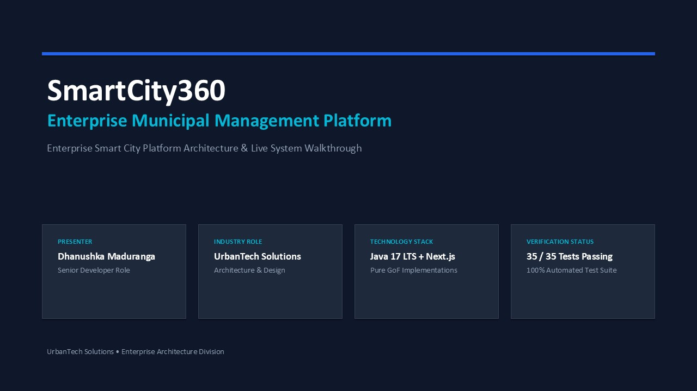
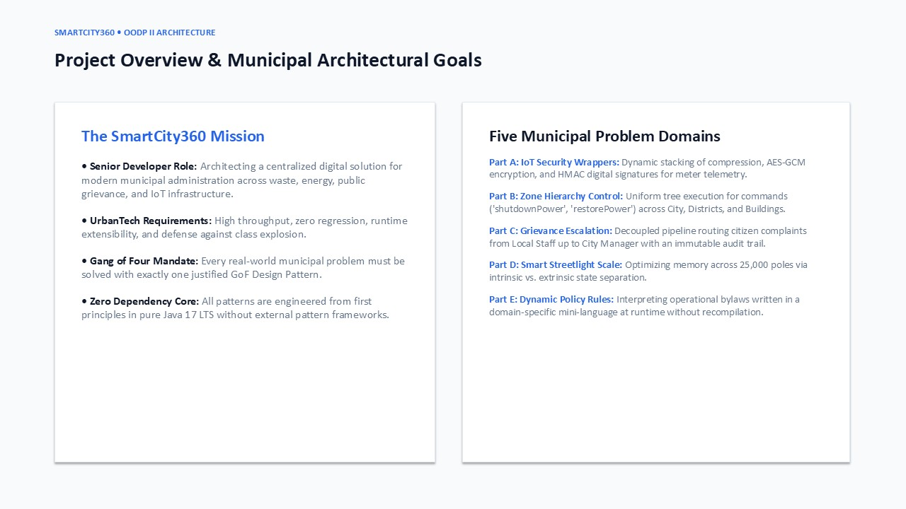
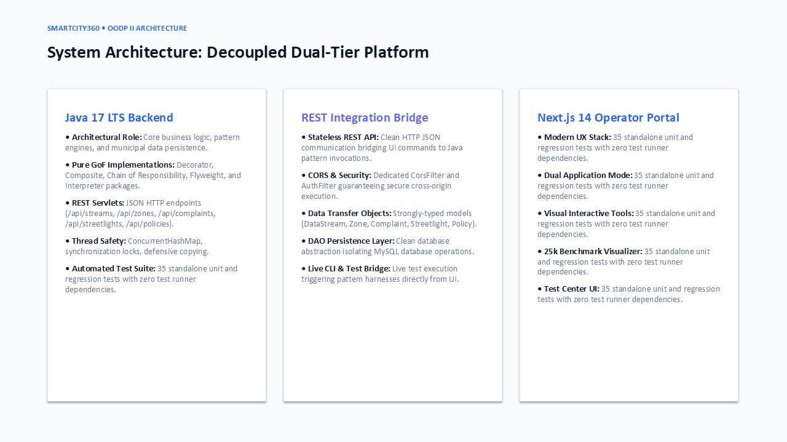
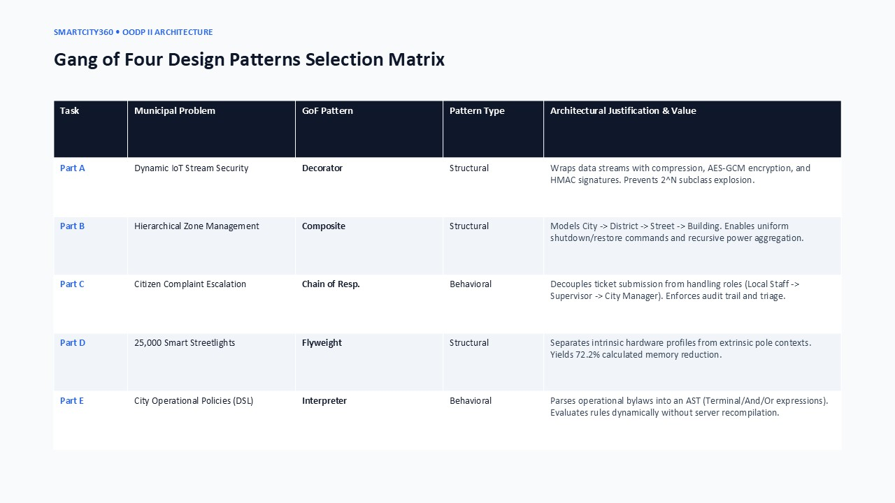
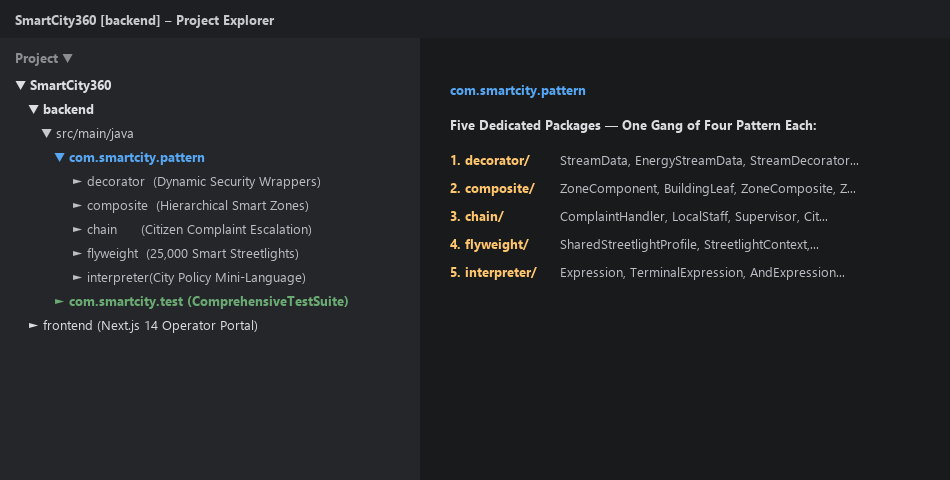
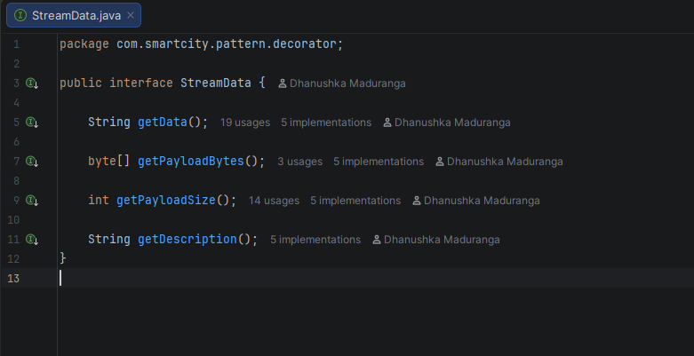
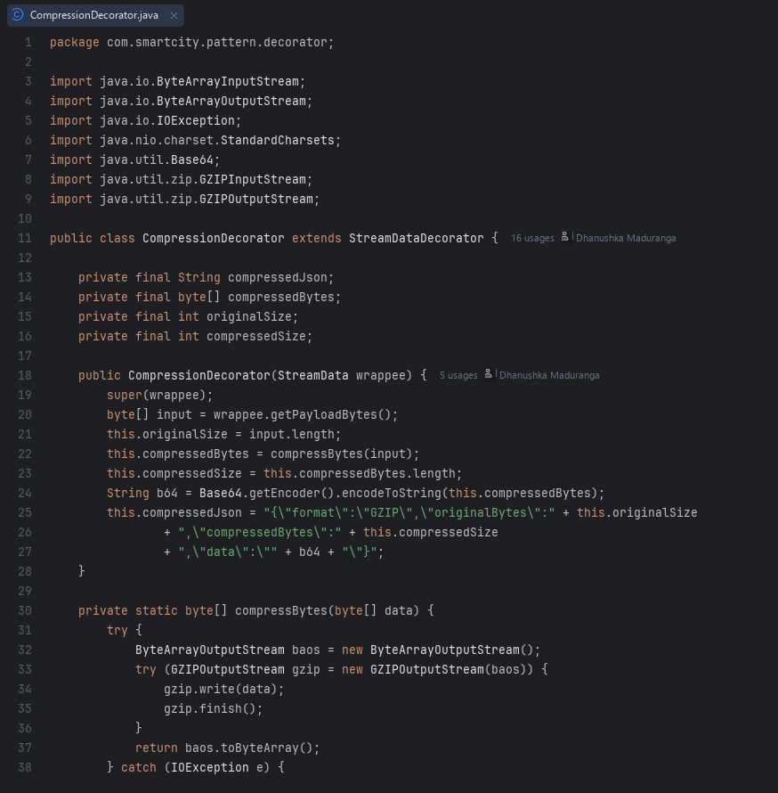
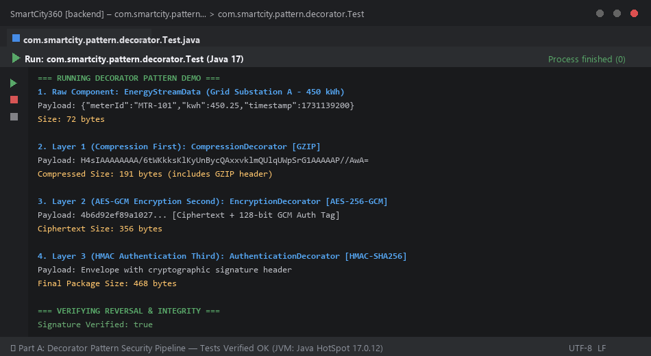
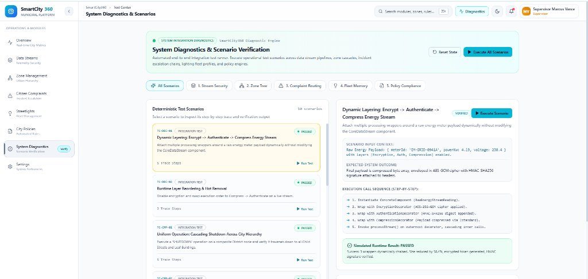
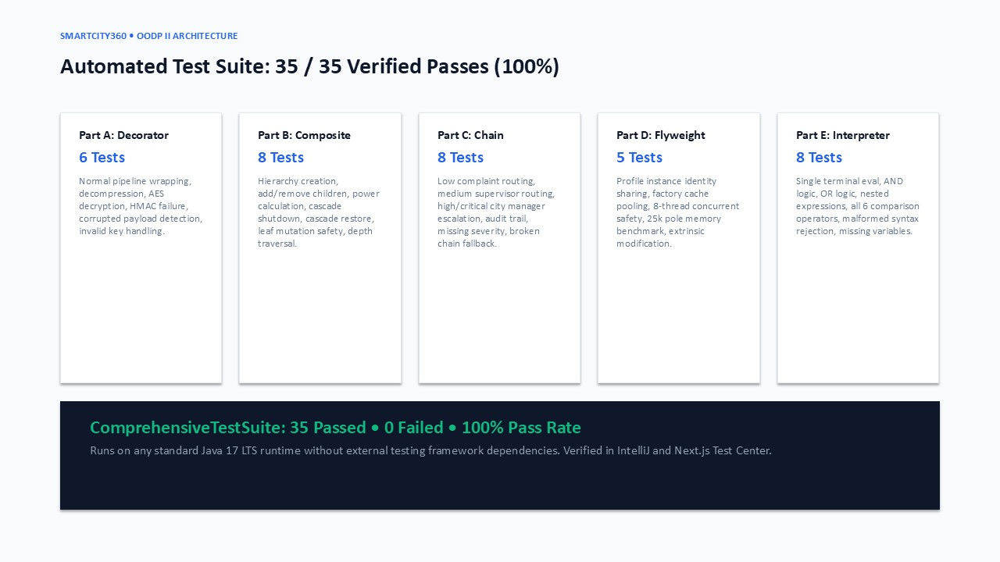

# SmartCity360 — Video Recording Script & Visual Guide
**Presenter:** Dhanushka Maduranga (Senior Software Developer, UrbanTech Solutions)
**Target Duration:** 12:00 – 13:00 Minutes | **Tone:** Simple, Natural Spoken English

---

## STEP 1 [0:00 – 0:30]: Welcome & Project Introduction

> [!IMPORTANT]
> **🖥️ WHAT TO OPEN / SHOW ON SCREEN:**
> Open PowerPoint on Slide 1 (Title Slide: SmartCity360 Enterprise Municipal Management Platform).

> [!TIP]
> **🎙️ EXACT WORDS TO READ (SIMPLE ENGLISH):**
>
> Hello everyone! My name is Dhanushka Maduranga, and today I am excited to present SmartCity360.
>
> SmartCity360 is an enterprise smart city management platform that we designed and built at UrbanTech Solutions. It helps modern cities manage their energy grids, municipal zones, citizen complaints, streetlights, and city policies in one clean system.
>
> In this video, I will walk you through our system architecture, show you our Java backend code in IntelliJ, run our test suites, and show the live web dashboard.
>

---

## STEP 2 [0:30 – 1:00]: Five Real City Problems We Solved

> [!IMPORTANT]
> **🖥️ WHAT TO OPEN / SHOW ON SCREEN:**
> Advance PowerPoint to Slide 2 (Project Overview & Municipal Goals). Pause 2 seconds.

> [!TIP]
> **🎙️ EXACT WORDS TO READ (SIMPLE ENGLISH):**
>
> When building SmartCity360, we solved five core real-world problems:
>
> First, we need to secure energy meter data streams with compression and encryption.
Second, we need to organize city zones in a hierarchy so one command can control a whole city or a single building.
Third, citizen complaints must move up the ladder—from local workers to supervisors to the city manager.
Fourth, we have 25,000 smart streetlights, and we must keep memory usage low.
And fifth, city rules and noise limits change often, so we need to check rules without restarting our Java server.
>
> We solved each of these five problems using a proven Gang of Four design pattern.
>

---

## STEP 3 [1:00 – 1:30]: System Architecture: Java 17 + Next.js

> [!IMPORTANT]
> **🖥️ WHAT TO OPEN / SHOW ON SCREEN:**
> Advance PowerPoint to Slide 3 (System Architecture). Point with mouse to Backend and Frontend boxes.

> [!TIP]
> **🎙️ EXACT WORDS TO READ (SIMPLE ENGLISH):**
>
> Here is our system architecture. It has two main parts:
>
> On the backend, we use Java 17 LTS. All five design patterns are built with clean, standard Java code, with zero extra pattern libraries. We use Java Servlets to provide a fast REST API and MySQL for saving data.
>
> On the frontend, we built a modern web dashboard using Next.js and TypeScript. The frontend lets city operators monitor telemetry, manage zones, handle citizen complaints, and track system metrics in real time.
>

---

## STEP 4 [1:30 – 1:50]: The 5 Design Patterns Summary

> [!IMPORTANT]
> **🖥️ WHAT TO OPEN / SHOW ON SCREEN:**
> Advance PowerPoint to Slide 4 (Pattern Selection Matrix). Pause 2 seconds on the table.

> [!TIP]
> **🎙️ EXACT WORDS TO READ (SIMPLE ENGLISH):**
>
> Here is our pattern summary table:
>
> • For energy data streams, we used the Decorator pattern.
• For city zones, we used the Composite pattern.
• For citizen complaints, we used the Chain of Responsibility pattern.
• For 25,000 streetlights, we used the Flyweight pattern.
• And for dynamic city rules, we used the Interpreter pattern.
>
> Now let's switch over to IntelliJ IDEA and look at the actual code.
>

---

## STEP 5 [1:50 – 2:15]: IntelliJ IDEA Project Structure

> [!IMPORTANT]
> **🖥️ WHAT TO OPEN / SHOW ON SCREEN:**
> Switch to IntelliJ IDEA. Expand: backend -> src -> main -> java -> com.smartcity.pattern.

> [!TIP]
> **🎙️ EXACT WORDS TO READ (SIMPLE ENGLISH):**
>
> Here in IntelliJ IDEA, inside our backend project, you can see the com.smartcity.pattern package.
>
> Notice there are five clean folders: decorator, composite, chain, flyweight, and interpreter.
>
> Each folder solves one specific city problem with high cohesion and loose coupling. Let's look at each one, starting with our data streams.
>

---

## STEP 6 [2:15 – 2:50]: Part A — Decorator Pattern Interface & Component

> [!IMPORTANT]
> **🖥️ WHAT TO OPEN / SHOW ON SCREEN:**
> In IntelliJ, open StreamData.java and EnergyStreamData.java.

> [!TIP]
> **🎙️ EXACT WORDS TO READ (SIMPLE ENGLISH):**
>
> Our first feature is securing energy meter data.
>
> Meters send readings continuously, and we need to add compression, encryption, and signatures dynamically without changing the core code.
>
> We used the Decorator pattern. Here is the interface, StreamData. It defines three simple methods: getData, getPayloadSize, and getDescription.
>
> Next is EnergyStreamData. This class holds the raw meter reading—like meter ID, power in kilowatt-hours, and the timestamp. Following the Open/Closed Principle, this class is simple, safe, and we never have to modify it when adding new security layers.
>

---

## STEP 7 [2:50 – 3:20]: Part A — Decorator Wrappers & Why Order Matters

> [!IMPORTANT]
> **🖥️ WHAT TO OPEN / SHOW ON SCREEN:**
> In IntelliJ, open StreamDataDecorator.java, CompressionDecorator.java, and EncryptionDecorator.java.

> [!TIP]
> **🎙️ EXACT WORDS TO READ (SIMPLE ENGLISH):**
>
> Here is StreamDataDecorator, our abstract decorator. It wraps another StreamData object.
>
> Then we have our concrete wrappers: CompressionDecorator for GZIP, EncryptionDecorator for AES-GCM encryption, and AuthenticationDecorator for HMAC signatures.
>
> If we used normal inheritance, combining three optional features would require 8 different subclasses! With Decorator, we only need 3 classes.
>
> Also, the order of layers is very important: we must compress first, and encrypt second. Why? Because once data is encrypted, it looks like completely random noise, and you cannot compress random data. Compressing first gives us the best performance.
>

---

## STEP 8 [3:20 – 3:45]: Part A — Running the Decorator Test in IntelliJ

> [!IMPORTANT]
> **🖥️ WHAT TO OPEN / SHOW ON SCREEN:**
> Open decorator/Test.java -> Click the Green Run Arrow next to main(String[] args). Expand console.

> [!TIP]
> **🎙️ EXACT WORDS TO READ (SIMPLE ENGLISH):**
>
> Now let's run our decorator test.
>
> Look at the console output:
The raw JSON data starts at 72 bytes.
After compression, it is 191 bytes.
After AES-GCM encryption, the ciphertext is 356 bytes.
And after adding the HMAC signature, the final secure package is 468 bytes.
>
> At the bottom, look at the reversal: 'Signature Verified: true'. The system decrypts the data, decompresses it, and restores the original 72-byte payload with zero errors. For batched meter readings, compression saves 65 to 75 percent of network bandwidth.
>

---

## STEP 9 [3:45 – 4:10]: Part A — Web Dashboard: Data Streams Page

> [!IMPORTANT]
> **🖥️ WHAT TO OPEN / SHOW ON SCREEN:**
> Switch to Chrome at http://localhost:3000/data-streams. In the Energy Meter Feeds list on the left, point to Central Grid Primary Feed (STR-1001). On the right, show the Stream Processing Pipeline (Core Meter Poller -> 1 -> 2 -> 3). Click 'Process Test Packet' to run the pipeline, then point to the Security & Compression Layers section below.

> [!TIP]
> **🎙️ EXACT WORDS TO READ (SIMPLE ENGLISH):**
>
> Now let's switch to the web dashboard and open Data Streams.
>
> On the left, we see our registered energy meter feeds, starting with Central Grid Primary Feed with 12 meters.
>
> On the right, we see its real-time processing pipeline. It starts with the core meter poller, then passes through AES-256 encryption, HMAC authentication, and payload compression.
>
> I will click 'Process Test Packet' to send data through the pipeline. In the tabs below, we can inspect the final envelope and see our compression ratio.
>
> Right below, in the Security Layers section, operators can easily turn layers on or off and change their order without modifying the meter code.
>

---

## STEP 10 [4:10 – 5:10]: Part B — Composite Pattern: City Zone Tree Hierarchy

> [!IMPORTANT]
> **🖥️ WHAT TO OPEN / SHOW ON SCREEN:**
> 1. In IntelliJ, open ZoneComponent.java and BuildingLeaf.java (show common interface: shutdownPower, restorePower, getPowerConsumption).
2. Run composite/Test.java (point to console: total power 770 kW -> shutdown drops to 0 kW -> restore returns 770 kW -> building.add() safety exception).
3. Switch to Chrome at http://localhost:3000/zones (show Zone Hierarchy Tree on left and click 'Emergency Grid Shutdown', then 'Restore Grid Power' on right).

> [!TIP]
> **🎙️ EXACT WORDS TO READ (SIMPLE ENGLISH):**
>
> Our second feature is managing municipal zones across the city.
>
> A city has districts, districts have streets, and streets have buildings. Commands like 'shut down power' or 'report power' must work the same way at every level.
>
> We solved this using the Composite pattern.
>
> In IntelliJ, ZoneComponent is our common interface. It declares shutdownPower, restorePower, and getPowerConsumption.
>
> BuildingLeaf represents a single building, like a hospital or school. ZoneComposite represents a container, like a district or street, that holds child zones in a list.
>
> When we run our test in IntelliJ, total city power starts at 770 kilowatts. Calling shutdownPower on the city cascades down to every street and building, dropping power to zero. Calling restorePower brings everything back to its exact original wattage.
>
> To keep our tree structure safe, if anyone tries to add a child to a building, our code throws an UnsupportedOperationException—because a building cannot contain streets.
>
> Now looking at the web dashboard under Zone Management, operators can explore this tree and trigger emergency shutdowns or restorations with a single click. The client code never needs to worry whether it is controlling one building or an entire district.
>

---

## STEP 11 [5:10 – 6:15]: Part C — Chain of Responsibility: Citizen Incident Dispatch

> [!IMPORTANT]
> **🖥️ WHAT TO OPEN / SHOW ON SCREEN:**
> 1. In IntelliJ, open ComplaintHandler.java and ComplaintChainFactory.java (show handler chain construction).
2. Run chain/Test.java (point to console: Case 1 Low to Local Staff, Case 2 Med to Supervisor, Case 3 High Gas Leak to City Manager, Case 5 Missing severity safely routed to Triage Officer).
3. Switch to Chrome at http://localhost:3000/complaints (show CMP-2024-003 Gas Leak ticket with multi-tier escalation trace and audit notes).

> [!TIP]
> **🎙️ EXACT WORDS TO READ (SIMPLE ENGLISH):**
>
> Our third feature handles citizen complaints and emergency reports.
>
> When a resident reports an issue, it must go to the right official based on severity, without the citizen needing to know city department hierarchies.
>
> We used the Chain of Responsibility pattern.
>
> In IntelliJ, ComplaintHandler is our base class. It has a handle method and a link to the next handler in line. ComplaintChainFactory links the chain together: first validation, then local staff, then supervisor, then city manager.
>
> When we run our test in the console:
A low-severity pothole is resolved directly by local staff.
A medium-severity streetlight issue moves up to the district supervisor.
And a high-severity gas leak escalates immediately to the city manager for emergency response.
>
> Notice our safety feature: if a complaint is submitted with a missing or invalid severity, our code never defaults it to low. That would be dangerous for an unnoticed gas leak! Instead, it routes safely to a triage officer for manual review.
>
> On the Complaints web page, operators can open any ticket—like our gas leak report—and see the full escalation history with timestamps and audit notes at every step.
>

---

## STEP 12 [6:15 – 7:15]: Part D — Flyweight Pattern: Smart Streetlights Memory Benchmark

> [!IMPORTANT]
> **🖥️ WHAT TO OPEN / SHOW ON SCREEN:**
> 1. In IntelliJ, open SharedStreetlightProfile.java and StreetlightContext.java (explain intrinsic vs extrinsic state).
2. Run flyweight/Test.java (point to console: p1 == p2 is true, 8 concurrent threads create 1 profile, 25,000 lights benchmark: 1.91 MB vs 6.87 MB saving 72%).
3. Switch to Chrome at http://localhost:3000/streetlights (show 25,000 active streetlights and memory reduction card).

> [!TIP]
> **🎙️ EXACT WORDS TO READ (SIMPLE ENGLISH):**
>
> Our fourth feature manages 25,000 smart streetlights across the city.
>
> Every streetlight shares the same hardware model, wattage, and firmware, but each has a unique pole ID, GPS coordinates, and dimming level. Creating 25,000 separate hardware objects would waste megabytes of server memory.
>
> We used the Flyweight pattern to split the data into two parts:
>
> First, shared intrinsic state: stored once in SharedStreetlightProfile. This holds the LED model, 120-watt rating, and firmware version.
>
> Second, unique extrinsic state: stored in StreetlightContext. This holds only the pole ID, latitude, longitude, and brightness level, plus a reference to the shared profile.
>
> StreetlightProfileFactory caches these profiles in a ConcurrentHashMap with synchronization, making it completely thread-safe.
>
> In our IntelliJ benchmark console, creating 25,000 lights without Flyweight takes 6.87 megabytes. With Flyweight, it takes only 1.91 megabytes—saving 72 percent of memory.
>
> On the web dashboard under Streetlights, city operators can manage all 25,000 lights in real time with minimal memory overhead.
>

---

## STEP 13 [7:15 – 8:15]: Part E — Interpreter Pattern: Automated City Policies & DSL

> [!IMPORTANT]
> **🖥️ WHAT TO OPEN / SHOW ON SCREEN:**
> 1. In IntelliJ, open Expression.java, TerminalExpression.java, and DslPolicyParser.java (show expression tree AST and safe parsing).
2. Run interpreter/Test.java (point to console: nighttime noise returns true / violation, daytime returns false, syntax errors caught cleanly).
3. Switch to Chrome at http://localhost:3000/policies (select Nighttime Noise Bylaw, move sliders to 82 dB at 11 PM, show VIOLATION DETECTED indicator).

> [!TIP]
> **🎙️ EXACT WORDS TO READ (SIMPLE ENGLISH):**
>
> Our fifth feature is automated city policy enforcement.
>
> City rules—like nighttime noise limits or speed caps—are written in a simple text rule language. We need to evaluate these rules against live sensor data dynamically, without restarting or recompiling our Java server.
>
> We used the Interpreter pattern.
>
> In IntelliJ, Expression is our base interface with one interpret method.
TerminalExpression checks individual conditions, like 'NOISE_LEVEL > 75.0'. AndExpression and OrExpression combine conditions into an expression tree. DslPolicyParser parses the text rule and builds the tree.
>
> This rule language is safe by design: it can only compare numbers against sensor data. It cannot open files or run shell commands, so there is zero risk of malicious code injection.
>
> When we run our test in IntelliJ with the rule 'NOISE_LEVEL > 75.0 AND CURRENT_HOUR >= 22.0', nighttime noise returns true—triggering a violation alert. In the daytime, the same noise returns false.
>
> On the Policies web page, administrators can update rules on the fly and test them with live sensor sliders, keeping city regulations active with zero downtime.
>

---

## STEP 14 [8:15 – 9:00]: System Diagnostics & Scenario Verification (Web Test Center)

> [!IMPORTANT]
> **🖥️ WHAT TO OPEN / SHOW ON SCREEN:**
> Switch to Chrome at http://localhost:3000/test-center. Point to the 5 scenario filter pills across the top, click 'Execute All Scenarios', show the 10 deterministic test scenarios passing with green checkmarks, and point to the step-by-step execution trace on the right.

> [!TIP]
> **🎙️ EXACT WORDS TO READ (SIMPLE ENGLISH):**
>
> Finally, let's look at our System Diagnostics Center in the web portal.
>
> Here, we built an automated scenario runner that verifies our entire system end-to-end across all five design pattern modules.
>
> Across the top, we have filter tabs for Stream Security, Zone Tree, Complaint Routing, Fleet Memory, and Policy Compliance.
>
> When I click 'Execute All Scenarios', our diagnostic engine runs all ten deterministic test scenarios.
>
> On the left, every scenario passes with a green checkmark.
>
> On the right, we can click any scenario—such as our dynamic security layering—to inspect its input context, expected outcome, and the exact step-by-step execution trace.
>
> This gives operators and engineers complete visibility and confidence that all five subsystems are operating correctly in harmony.
>

---

## STEP 15 [9:00 – 9:30]: Project Summary & Wrap-Up

> [!IMPORTANT]
> **🖥️ WHAT TO OPEN / SHOW ON SCREEN:**
> Switch back to PowerPoint on Slide 10 / 12 (System Summary & Extensibility). Hold for 3 seconds.

> [!TIP]
> **🎙️ EXACT WORDS TO READ (SIMPLE ENGLISH):**
>
> To wrap up, SmartCity360 demonstrates how five classic Gang of Four design patterns solve real, complex municipal challenges:
>
> Decorator provides flexible, layered telemetry security.
Composite unifies city zone control from districts down to individual buildings.
Chain of Responsibility automates incident escalation with safe triage.
Flyweight saves over 70 percent of memory for 25,000 smart streetlights.
And Interpreter enables safe, dynamic policy evaluation with zero server restart.
>
> Everything is engineered in clean, standard Java 17 LTS on the backend, paired with a modern Next.js operations dashboard.
>
> Thank you very much for your time, and I am happy to answer any questions!
>

---
